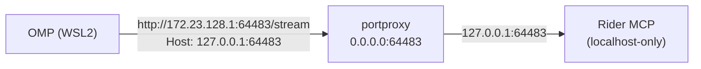

# JetBrains Rider MCP в Oh My Pi (WSL2)

## Назначение

Инструкция для агента, который должен подключить MCP-сервер JetBrains Rider к Oh My Pi (OMP), когда OMP работает в WSL2, а Rider — на Windows-хосте.

Целевой результат:

- OMP вызывает инструменты Rider MCP (`xd://mcp__rider_*`) из WSL;
- конфиг содержит только `url` и заголовок `Host` — без привязки к конкретному проекту;
- проброс порта воспроизводим и переживает перезапуск.

## Как это работает

Rider поднимает MCP-сервер автоматически при открытом проекте (plugin `mcpserver`, поставляется с IDE). Две особенности, определяющие всю схему подключения:

1. **Сервер слушает только `127.0.0.1` на Windows.** Из WSL2 (NAT-режим) Windows-localhost недоступен — нужен проброс порта на стороне Windows.
2. **Сервер проверяет заголовок `Host`** и отклоняет запросы с чужим `Host` (403 Forbidden). Клиент из WSL обязан подменять `Host` на `127.0.0.1:<порт>`.

Порт **не фиксирован**: Rider выбирает свободный порт при запуске (наблюдались 64482, 64483). Актуальный порт и готовый конфиг Rider показывает в `Settings → Tools → MCP Server` (раздел ручной настройки клиентов), например:

```json
{
  "type": "streamable-http",
  "url": "http://127.0.0.1:64483/stream",
  "headers": {
    "IJ_MCP_SERVER_PROJECT_PATH": "D:/study/mpl/kursach"
  }
}
```

Заголовок `IJ_MCP_SERVER_PROJECT_PATH` нужен только когда открыто несколько проектов и клиент должен выбрать конкретный. В глобальный конфиг OMP он **не пишется** (конфиг общий для всех проектов): без заголовка сервер обслуживает текущий активный проект. Проверено: handshake без заголовка проходит, инструменты доступны.

Схема соединения:



## Предварительные условия

- Rider запущен на Windows с открытым проектом, MCP-сервер включён (`Settings → Tools → MCP Server`).
- Известен актуальный порт из настроек Rider (далее в примерах — `64483`; подставлять свой).

Узнать IP Windows-хоста из WSL:

```bash
ip route show default | awk '{print $3}'
```

Ожидаемый результат: IP вида `172.x.x.1`. Он нестабилен между перезапусками WSL, но portproxy и конфиг переживают его смену, т.к. portproxy слушает `0.0.0.0`, а конфиг можно указывать на текущий default route.

## Проброс порта на Windows (portproxy + файрвол)

Выполняется **один раз на порт**, от имени администратора Windows. Из WSL запуск с повышением прав (появится UAC-запрос на стороне Windows — подтвердить):

```bash
PORT=64483
powershell.exe -NoProfile -Command "Start-Process powershell -Verb RunAs -Wait -ArgumentList '-NoProfile','-Command',\"netsh interface portproxy add v4tov4 listenport=$PORT listenaddress=0.0.0.0 connectport=$PORT connectaddress=127.0.0.1; New-NetFirewallRule -DisplayName 'Rider MCP (WSL)' -Direction Inbound -Protocol TCP -LocalPort $PORT -Action Allow | Out-Null\""
```

Если порт уже проброшен (старое правило на другой порт), сначала удалить его:

```powershell
netsh interface portproxy delete v4tov4 listenport=<старый_порт> listenaddress=0.0.0.0
```

Проверка правила:

```bash
powershell.exe -NoProfile -Command "netsh interface portproxy show v4tov4"
```

Ожидаемый результат: строка `0.0.0.0  <порт>  127.0.0.1  <порт>`.

Portproxy хранится в реестре Windows и переживает перезагрузку; служба `iphlpsvc` должна быть запущена (по умолчанию так и есть).

## Подключение к OMP

В `~/.omp/agent/mcp.json` добавить в `mcpServers`:

```json
"rider": {
  "type": "http",
  "url": "http://172.23.128.1:64483/stream",
  "headers": {
    "Host": "127.0.0.1:64483"
  }
}
```

- `url` — IP Windows-хоста (default route WSL) + актуальный порт Rider.
- `Host` — обязательно `127.0.0.1:<порт>`, иначе 403.
- `IJ_MCP_SERVER_PROJECT_PATH` **не указывать**: глобальный конфиг общий, а сервер без него обслуживает активный проект.

После правки конфига перезапустить OMP: MCP-серверы монтируются при старте сессии.

## Проектное переопределение (привязка к проекту Rider)

Глобальный конфиг общий и не привязан к проекту Rider. Если нужна жёсткая привязка — переопределить сервер `rider` на уровне проекта, добавив заголовок `IJ_MCP_SERVER_PROJECT_PATH`.

OMP читает MCP-конфиги в порядке (первый выигрывает при совпадении имени сервера):

1. `.omp/mcp.json` и `.omp/.mcp.json` в корне проекта;
2. `mcp.json` и `.mcp.json` в корне проекта (fallback-провайдер);
3. `~/.omp/agent/mcp.json` (глобальный, user-уровень).

Дедупликация по имени: проектная запись **полностью заменяет** одноимённую глобальную — слияния заголовков нет, поэтому `url` и `Host` в проектной записи обязательны. Дать проектному серверу другое имя при том же `url` нельзя: сработает семантическая дедупликация по эквивалентности (same url+command), и один из них будет отброшен.

Пример `.omp/mcp.json` в корне проекта:

```json
{
  "mcpServers": {
    "rider": {
      "type": "http",
      "url": "http://172.23.128.1:64483/stream",
      "headers": {
        "Host": "127.0.0.1:64483",
        "IJ_MCP_SERVER_PROJECT_PATH": "D:/study/mpl/kursach"
      }
    }
  }
}
```

`IJ_MCP_SERVER_PROJECT_PATH` — путь к проекту в нотации Windows (как в `Settings → Tools → MCP Server`), слэши прямые. Полезен, когда в Rider открыто несколько проектов: без заголовка сервер обслуживает активный, с заголовком — указанный.

Источники поведения слияния: `packages/coding-agent/src/discovery/builtin.ts` (порядок чтения), `packages/coding-agent/src/capability/index.ts` (дедупликация first-wins).

## Проверка установки

По цепочке, каждый шаг локализует отказ:

1. Rider слушает порт на localhost Windows:

```bash
powershell.exe -NoProfile -Command "netstat -ano | Select-String ':64483.*LISTENING'"
```

Ожидаемый результат: `TCP 127.0.0.1:64483 ... LISTENING` с PID процесса `rider64`.

2. Проброс доступен из WSL (TCP):

```bash
timeout 3 bash -c "echo > /dev/tcp/172.23.128.1/64483" && echo open
```

Ожидаемый результат: `open`.

3. MCP-handshake (подмена `Host` обязательна и здесь):

```bash
curl -sS -m 10 -X POST \
  -H 'Content-Type: application/json' \
  -H 'Accept: application/json, text/event-stream' \
  -H 'Host: 127.0.0.1:64483' \
  -d '{"jsonrpc":"2.0","id":1,"method":"initialize","params":{"protocolVersion":"2025-03-26","capabilities":{},"clientInfo":{"name":"probe","version":"0.1"}}}' \
  http://172.23.128.1:64483/stream
```

Ожидаемый результат: JSON с `"serverInfo":{"name":"JetBrains Rider MCP Server",...}`.

4. В новой OMP-сессии инструменты `xd://mcp__rider_*` присутствуют в списке MCP-роутов.

## Диагностика (troubleshooting)

### `Connection timed out` при обращении к порту с IP Windows-хоста

Симптом: `curl` к `http://172.x.x.1:<порт>/stream` висит и падает по таймауту.

Причины по убыванию вероятности:

1. **Нет portproxy-правила** (порт сменился после перезапуска/обновления Rider, а проброшен старый). Проверить: `netstat` на Windows (шаг 1 проверки) и `portproxy show v4tov4`. Лечение: удалить правило на старый порт, добавить на новый.
2. **Нет правила файрвола** для порта. Добавить `New-NetFirewallRule` (см. «Проброс порта»).
3. **IP Windows-хоста сменился** после `wsl --shutdown`. Узнать заново: `ip route show default`.

### `403 Forbidden`

JetBrains MCP отклонил запрос из-за заголовка `Host`. Проверить, что в `mcp.json` и в `curl` передаётся `Host: 127.0.0.1:<актуальный_порт>` — порт в `Host` должен совпадать с портом в `url`.

### `Connection refused` на `127.0.0.1:<порт>` внутри WSL

Rider MCP — это localhost **Windows**, а не WSL. В NAT-режиме WSL2 `127.0.0.1` указывает на саму WSL. Либо пробрасывать порт через portproxy (основная схема этого документа), либо включить `networkingMode=mirrored` в `%UserProfile%\.wslconfig` — тогда localhost общий и проброс не нужен (требует Windows 11 22H2+ и `wsl --shutdown`).

### Инструменты `rider` не появляются в OMP-сессии

1. Проверить валидность JSON: `python3 -m json.tool ~/.omp/agent/mcp.json`.
2. MCP монтируются только при старте сессии — открыть новую сессию.
3. Проверить, что сервер не попал в `disabledServers` в `mcp.json`.

### Инструменты видны, но вызовы падают / пустой проект

Rider MCP обслуживает **открытый в данный момент проект**. Если проект не открыт или открыт другой — инструменты вернут ошибку или данные чужого проекта. Лечение: открыть нужный проект в Rider. Жёсткая привязка через `IJ_MCP_SERVER_PROJECT_PATH` возможна только в проектном (не глобальном) конфиге.

### Порт изменился после обновления Rider

Порт не фиксирован. Минимальный ритуал восстановления:

```bash
# 1. Узнать новый порт: Settings → Tools → MCP Server в Rider (или netstat по PID rider64)
# 2. Пересоздать portproxy (UAC):
powershell.exe -NoProfile -Command "Start-Process powershell -Verb RunAs -Wait -ArgumentList '-NoProfile','-Command',\"netsh interface portproxy delete v4tov4 listenport=<старый> listenaddress=0.0.0.0; netsh interface portproxy add v4tov4 listenport=<новый> listenaddress=0.0.0.0 connectport=<новый> connectaddress=127.0.0.1; New-NetFirewallRule -DisplayName 'Rider MCP (WSL) <новый>' -Direction Inbound -Protocol TCP -LocalPort <новый> -Action Allow | Out-Null\""
# 3. Обновить порт в двух местах ~/.omp/agent/mcp.json: url и Host
```

## Удаление

Убрать запись `rider` из `~/.omp/agent/mcp.json`. На Windows (от администратора):

```powershell
netsh interface portproxy delete v4tov4 listenport=<порт> listenaddress=0.0.0.0
Remove-NetFirewallRule -DisplayName 'Rider MCP (WSL)*'
```

## Источники

- [JetBrains MCP Server plugin](https://plugins.jetbrains.com/plugin/26071-mcp-server)
- [Model Context Protocol — Streamable HTTP](https://modelcontextprotocol.io/specification/2025-03-26/basic/transports#streamable-http)
- [netsh interface portproxy](https://learn.microsoft.com/en-us/windows-server/networking/technologies/netsh/netsh-interface-portproxy)
